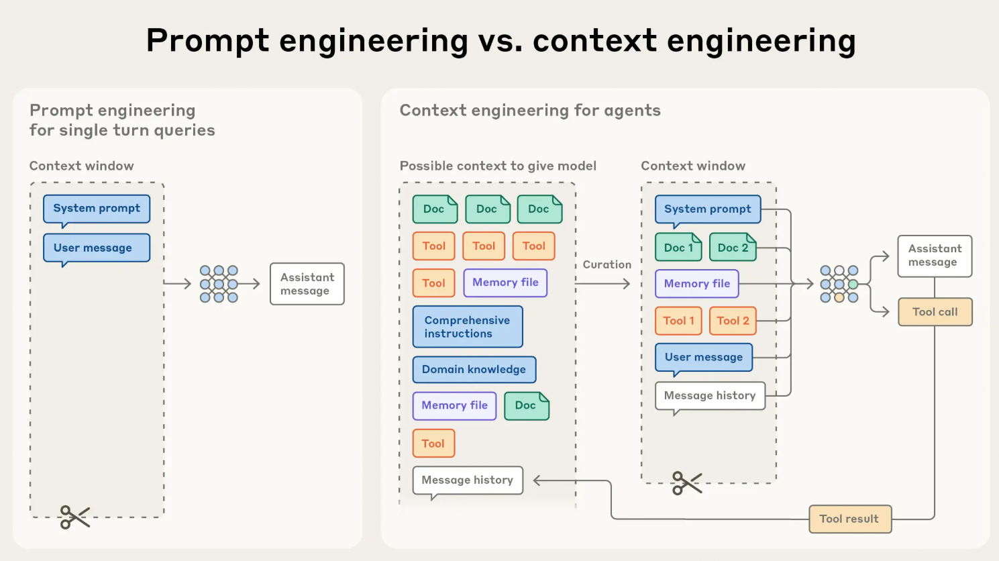
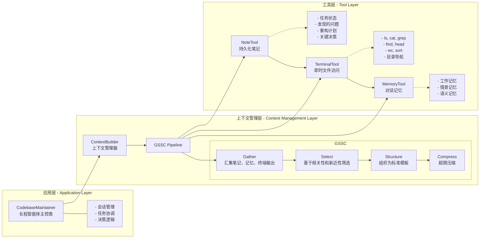

## 9.1 什么是上下文工程

- 构建：什么样的上下文配置，最有可能让模型产出我们期望的行为？
- 目标：在推理阶段，如何策划与维护“最优的信息集合（tokens） 



## 9.2 为什么上下文工程重要

LLM和人类一样，在一定点上会"走神" 或 "混乱"。
此外，模型的注意力模式来源于训练数据分布——短序列通常比长序列更常见，因此模型对“全上下文依赖”的经验更少、专门参数也更少

围绕下列2项开展工程化建设
1. System Prompt: 语言清晰、直白。信息层级把握在"刚刚好"的高度。常见两极误区
   1. 过度硬编码: 写入过多复杂脆弱的逻辑
   2. 过于空泛
2. Tools: 工具定义了智能体与信息/行动空间的契约，必须促进效率：既要返回token 友好的信息，又要鼓励高效的智能体行为
   1. 职责单一、互相低重叠，接口语义清晰
   2. 对错误鲁棒
   3. 入参描述明确、无歧义，充分发挥模型擅长的表达与推理能力。


面向长时程任务的上下文工程
1. 压缩整合-Compaction
2. 结构化笔记-Structed note-taking 
   1. 定义： 智能体记忆。智能体以固定频率将关键信息写入上下文外的持久化存储。在后续阶段按需拉回
   2. 价值：以极低的上下文开销维持持久状态和依赖关系，如TODO列表、关键结论/依赖/阻塞项的索引
   3. 说明：在非编码场景中同样有效
3. 子代理架构-Sub-agent architectures
   1. 思想：由主代理负责高层规划和综合，多个专常子代理在“干净的上下文窗口”中各自深挖、调用工具并探索，最后仅回传凝练摘要
   2. 好处：实现关注点分离。庞杂的搜索上下文留在子代理内部，主代理专注于整合与推理；适合需要并行探索的复杂研究/分析任务。
   3. 经验：公开的多智能体研究系统显示，该模式在复杂研究任务上相较单代理基线具有显著优势。

经验法则：
- 压缩整合：现在是标配(2026.09)
- 结构化笔记：现在很多harness中也有这种思路不过有时候叫做  state
- 子代理：现在也是标配(2026.09)


## 9.3 在Hello-Agents中的实践： ContextBuilder

`ContextBuilder`的设计理念是“简单高效”，去除不必要的复杂性，统一“相关性+新近性”的分数进行选择，符合Agent模块化与可维护性的工程取向

#### 设计动机与目标

1. 统一入口：将“Gather-Select-Structure-Compress”抽象为可复用流水线，减少在Agent实现中的重复模板代码。
2. 稳定形态：输出固定骨架的上下文模板，便于调试、A/B测试与评估
   1.  `Role & Policies` : 明确 Agent 的角色定位和行为准则
   2.  `Task`: 当前需要完成的具体任务
   3.  `State`: Agent的当前状态和上下文信息
   4.  `Evidence`: 从外部只是库检索的证据信息
   5.  `Context`: 历史对话和相关记忆
   6.  `Output`：期望的输出格式和要求
3.  预算守护 ：在 token 预算内尽量保留高价值信息，对超限上下文提供兜底压缩策略。这确保了即使在信息量巨大的场景下，系统也能稳定运行。
4.  最小规则：不引入来源/优先级等分类维度，避免复杂度增长。实践表明，基于相关性和新近性的简单评分机制，在大多数场景下已经足够有效。

#### 核心数据结构

```python
from dataclass import dataclass
from typing import Optional, Dict, Any
from datetime import datetime 


@dataclass
class ContextPacket:
   """候选信息包
   Attributes:
      content: 信息内容
      timestamp: 时间戳
      token_count: Token数量
      relevance_score： 相关性分数(0.0-1.0)
      metadata: 可选的元数据
   """
   content: str
   timestamp: datetime
   token_count: int
   relevance_score: float = 0.5
   metadate: Optional[Dict[str, Any]] = None

   def __post_init__(self):
      """初始化后处理"""
      if self.metadata is None:
         self.metadata = {}
      # 确保相关性分数在有效范围内
      self.relevance_score = max(0.0, min(self.relevance_score, 1.0))


@dataclass
class ContextConfig:
   """上下文构建配置
   Attributes:
      max_tokens: 最大 token 数量
      reserve_ratio: 为系统指令预留的比例(0.0-1.0)
      min_relevance: 最低相关性阈值
      enable_compression: 是否启用压缩
      recency_weight: 新近性权重
      relevance_weight: 相关性权重
   """
    max_tokens: int = 3000
    reserve_ratio: float = 0.2
    min_relevance: float = 0.1
    enable_compression: bool = True
    recency_weight: float = 0.3
    relevance_weight: float = 0.7

   def __post_init__(self):
      """验证配置参数"""
      assert 0.0 <= self.reserve_ratio <= 1.0, "reserve_ratio 必须在 [0, 1] 范围内"
      assert 0.0 <= self.min_relevance <= 1.0, "min_relevance 必须在 [0, 1] 范围内"
      assert abs(self.recency_weight + self.relevance_weight - 1.0) < 1e-6, \
         "recency_weight + relevance_weight 必须等于 1.0"
      
   def _gather(
      self,
      user_query: str,
      conversation_history: Optional[List[Message]] = None,
      system_instructions: Optional[str] = None,
      custom_packets: Optional[List[ContextPacket]] = None
   ): #-> List[ContextPacket]:
      """汇集所有候选信息

      Args:
         user_query: 用户查询
         conversation_history: 对话历史
         system_instructions: 系统指令
         custom_packets: 自定义信息包

      Returns:
         List[ContextPacket]: 候选信息列表
      """
      packets = []

      # 1- 添加系统指令(最高优先级，不参与评分)
      if system_instructions:
         packets.append(ContextPacket(
            content=system_instructions,
            timestamp=datetime.now(),
            token_count=self._count_tokens(system_instructions),
            relevance_score=1.0,  # 系统指令始终保留
            metadata={"type": "system_instruction", "priority": "high"}
         ))
      
      # 2- 从记忆系统检索相关记忆
      if self.memory_tool:
         try:
            memory_results = self.memory_tool.run({
               "action" : "search",
               "query" : user_query,
               "limit" : 10,
               "min_importance": 0.3
            })
            # 解析记忆结果并转换为ContextPacket
            memory_packets = self._parse_memory_results(memory_results, user_query)
            packets.extend(memory_packets)
         except Exception as e:
            print(f"[WARNING] 记忆检索失败: {e}")
      
      # 3- 从RAG系统检索相关知识
      if self.rag_tool:
         try:
            rag_results = self.rag_tools.run({
               "action": "search",
               "query": user_query,
               "limit": 5,
               "min_score": 0.3
            })
            # 解析 RAG 结果并转换为 ContextPacket
            rag_packets = self._parse_rag_results(rag_results, user_query)
            packets.extend(rag_packets)
         except Exception as e:
            print(f"[WARNING] RAG 检索失败: {e}")

      # 4- 添加对话历史(仅保留最近的 N 条)
      if conversation_history:
         recent_history = conversation_history[-5:]
         for msg in recent_history:
            packets.append(ContextPacket(
               content=f'{msg.role}: {msg.content}',
               timestamp=msg.timestamp if hasattr(msg, 'timestamp') else datetime.now(),
               token_count=self._count_tokens(msg.content),
               relevance_score=0.6,  # 历史消息的基础相关性
               metadata={"type": "conversation_history", "role": msg.role}
            ))

      # 5- 添加自定义信息包
      if custom_packets:
         packets.extend(customer_packets)
      
   print(f"[ContextBuilder] 汇集了 {len(packets)} 个候选信息包")
   return packets

   # 智能信息选择
   def _select(
      self,
      packets: List[ContextPacket],
      user_query: str,
      available_tokens: int
   ):
      """选择最相关的信息包

      Args:
         packets: 候选信息包列表
         user_query: 用户查询(用于计算相关性)
         available_tokens: 可用的 token 数量

      Returns:
         List[ContextPacket]: 选中的信息包列表
      """
      # 1- 分离系统指令和其他信息
      system_packets = [p for p in packets if p.metadata.get("type") == "system_instruction"]
      other_packets = [p for p in packets if p.metadata.get("type") != "system_instruction"]

      # 2-计算系统指令占用的token
      system_tokens = sum(p.token_count for p in system_packets)
      remaining_tokens = available_tokens - system_tokens

      if remaining_tokens <= 0:
         print("[WARNING] 系统指令已占满所有 token 预算")
         return system_packets

      # 3- 为其他信息计算综合分数
      scored_packets = []
      for packet in other_packets:
         # 计算相关性分数(如果尚未计算)
         if packet.relevance_score == 0.5: # 默认值,需要重新计算
            relevance = self._calculate_relevance(packet.content, user_query)
            packet.relevance_score = relevance

         # 计算新近性分数
         recency = self._calculate_recency(packet.timestamp)

         # 综合分数 = 相关性权重 × 相关性 + 新近性权重 × 新近性
         combined_score = (
               self.config.relevance_weight * packet.relevance_score +
               self.config.recency_weight * recency
         )
         # 过滤低于最小相关性阈值的信息
         if packet.relevance_score >= self.config.min_relevance:
               scored_packets.append((combined_score, packet))

      # 4. 按分数降序排序
      scored_packets.sort(key=lambda x: x[0], reverse=True)
      # 5. 贪心选择：按分支从高到底填充，直到达到 token 上限
      selected = system_packets.copy()
      current_tokens = system_tokens
      for score, packet in scored_packets:
         if current_tokens + packet.token_count <= available_tokens:
               selected.append(packet)
               current_tokens += packet.token_count
         else:
               # Token 预算已满,停止选择
               break

      print(f"[ContextBuilder] 选择了 {len(selected)} 个信息包,共 {current_tokens} tokens")
      return selected

   def _calculate_relevance(self, content: str, query: str) -> float:
      """计算内容与查询的相关性

      使用简单的关键词重叠算法。在生产环境中,可以替换为向量相似度计算。

      Args:
         content: 内容文本
         query: 查询文本

      Returns:
         float: 相关性分数(0.0-1.0)
      """
      # 分词(简单实现,可以使用更复杂的分词器)
      content_words = set(content.lower().split())
      query_words = set(query.lower().split())

      if not query_words:
         return 0.0

      # Jaccard 相似度
      intersection = content_words & query_words
      union = content_words | query_words

      return len(intersection) / len(union) if union else 0.0

   def _calculate_recency(self, timestamp: datetime) -> float:
      """计算时间近因性分数

      使用指数衰减模型,24小时内保持高分,之后逐渐衰减。

      Args:
         timestamp: 信息的时间戳

      Returns:
         float: 新近性分数(0.0-1.0)
      """
      import math

      age_hours = (datetime.now() - timestamp).total_seconds() / 3600

      # 指数衰减:24小时内保持高分,之后逐渐衰减
      decay_factor = 0.1  # 衰减系数
      recency_score = math.exp(-decay_factor * age_hours / 24)

      return max(0.1, min(1.0, recency_score))  # 限制在 [0.1, 1.0] 范围内

   # Structure：结构化输出
   #  - 可读性：清晰的分区让人类和模型都更容易理解上下文结构
   #  - 可调式性：问题定位更容易，可以快速识别那个区域的信息有问题
   #  - 可拓展性：添加新的信息源只需要创建新的分区
   def _structure(self, selected_packets: List[ContextPacket], user_query: str):
      """将选中的信息包组织成结构化的上下文模板

      Args:
         selected_packets: 选中的信息包列表
         user_query: 用户查询

      Returns:
         str: 结构化的上下文字符串
      """
      # 按类型分组
      system_instructions = []
      evidence = []
      context = []

      for packet in selected_packets:
         packet_type = packet.metadata.get("type", "general")

         if packet_type == "system_instruction":
            system_instructions.append(packet.content)
         elif packet_type in ['rag_result', 'knowledge']:
            evidence.append(packet.content)
         else:
            context.append(packet.content)
      
      #  构建结构化模版
      sections = []

      # [Role & Policies]
      if system_instructions:
         sections.append("[Role & Policies]\n" + "\n".join(system_instructions))
      
      # [Task]
      sections.append(f"[Task]\n{user_query}")

      # [Evidence]
      if evidence:
         sections.append("[Evidence]\n" + "\n---\n".join(evidence))

      # [Context]
      if context:
         sections.append("[Context]\n" + "\n".join(context))
      
      # [Output]
      sections.append("[Output]\n请基于以上信息，提供准确、有据的回答。")

      return "\n\n".join(sections)

   def _compress(self, context: str, max_token: int):
      """压缩超限的上下文

      Args:
         context: 原始上下文
         max_tokens: 最大 token 限制

      Returns:
         str: 压缩后的上下文
      """
      current_tokens = self._count_tokens(context)
      if current_tokens <= max_token:
         return context
      
      print(f"[ContextBuilder]上下文超限({current_tokens} > {max_token}), 执行压缩")

      # 分区压缩：保持结构完整性
      sections = context.split("\n\n")
      compressed_sections = []
      current_total = 0
      for section in sections:
         section_tokens = self._count_tokens(section)
         if current_total + section_tokens <= max_tokens:
            # 完整
            compressed_sections.append(section)
            current_total += section_tokens 
         else:
            # 部分保留
            remaining_tokens = max_tokens - current_total
            if remaining_tokens > 50:  # 至少保留 50 tokens
               # 简单截断(生产环境可以使用LLM摘要)
               truncated = self._truncate_text(section, remaining_tokens)
               compressed_sections.append(truncated + "\n[... 内容已压缩 ...]")
            break
      
      compressed_context = "\n\n".join(compressed_sections)
      final_tokens = self._count_tokens(compressed_context)
      print(f"[ContextBuilder] 压缩完成: {current_tokens} -> {final_task} tokens")
      return compressed_context

   def _truncate_text(self, text: str, max_tokens: int):
      """截断文本到指定 token  数量
       Args:
         text: 原始文本
         max_tokens: 最大 token 数量
      
      Returns:
         str:  截断后的文本
      """
      # 简单实现：接字符比例估算
      # 生产环境中应该使用精确的 token 
      char_per_token = len(text) / self._count_tokens(text) if self._count_tokens(text) > 0 else 4 
      max_chars = int(max_tokens * char_per_token)
      return text[:max_chars]
   
   def _count_tokens(self, text: str):
      """估算文本的 token 数量
      Args:
         text: 文本内容
      Returns:
         int: token 数量
      """
      if not text:
         return 0

      def is_cjk(ch: str):
         # CJK 基本区 + 扩展A，含中文标点（，。《》等）
         return ('\u4e00' <= ch <= '\u9fff'
                  or '\u3400' <= ch <= '\u4dbf'
                  or '\u3000' <= ch <= '\u303f'
                  or '\uff00' <= ch <= '\uffef')

      # 1) 中文字符按 1 字 1 token
      chinese_chars = sum(1 for ch in text if is_cjk(ch))

      # 2) 剩余部分按英文规则估，取两种口径的较大值：
      #    单词数 * 1.3 或 非空白字符数 / 4（1 token ≈ 4 英文字符）
      rest = ''.join(ch for ch in text if not is_cjk(ch))
      english_words = len(rest.split())
      other_chars = sum(1 for ch in rest if not ch.isspace())
      english_tokens = max(english_words * 1.3, other_chars / 4)

      # 3) 10% 余量（注释里写了，原代码没做）
      return int((chinese_chars + english_tokens) * 1.1)
```


#### 完整使用示例

#### 接入Agents

```python
from hello_agents import SimpleAgent, HelloAgentsLLM, ToolRegistry
from hello_agents.context import ContextBuilder, ContextConfig
from hello_agents.tools import MemoryTools, RAGTools

class ContextAwareAgent(SimpleAgent):
   def __init__(self, name: str, llm: HelloAgentsLLM, **kwargs):
      super().__init__(
         name=name,
         llm=llm,
         system_prompt=kwargs.get("system_prompt", '')  
      )

      # 初始化上下文构建器
      self.memory_tool = MemoryTool(user_id=kwargs.get("user_id", "default"))
      self.rag_tool = RAGTool(knowledge_base_path=kwargs.get("knowledge_base_path", "./kb"))

        self.context_builder = ContextBuilder(
            memory_tool=self.memory_tool,
            rag_tool=self.rag_tool,
            config=ContextConfig(max_tokens=4000)
        )

        self.conversation_history = []
      
   def run(self, user_input: str):
      # 1- 使用ContextBulider 构建优化的上下文
      optimized_count = self.context_builder.build(
         user_query=user_input,
         conversation_history=self.conversation_history,
         system_instructions=self.system_prompt
      )

      # 2. 使用优化后的上下文调用 LLM
      messages = [
         {"role": "system", "content": optimized_context},
         {"role": "user", "content": user_input}
      ]
      response = self.llm.invoke(messages)

      # 3. 更新对话历史
      from hello_agents.core.message import Message
      from datetime import datetime

      self.conversation_history.append(
         Message(content=user_input, role="user", timestamp=datetime.now())
      )
      self.conversation_history.append(
         Message(content=response, role="assistant", timestamp=datetime.now())
      )

      # 4- 将重要交互记录到记忆系统
      self.memory_tool.run({
         "action": "add",
         "content": f"Q: {user_input}\nA: {response[:200]}...",  # 摘要
         "memory_type": "episodic",
         "importance": 0.6
      })

      return response


# 使用示例
agent = ContextAwareAgent(
    name="数据分析顾问",
    llm=HelloAgentsLLM(),
    system_prompt="你是一位资深的Python数据工程顾问。",
    user_id="user123",
    knowledge_base_path="./data_science_kb"
)

response = agent.run("如何优化Pandas的内存占用?")
print(response)

```


---


### 附录-和Claude上下文的比较

## 9.4 NoteTool: 结构笔记

> NoteTool 是为"长时程" 提供的结构化外部记忆组件
> 它以 Markdown 文件作为载体，头部使用YAML 前置元数据记录关键信息，正文用于记录状态、结论、阻塞与行动项等内容。

1. 为什么需要NoteTool
   - 需要长期追踪、结构化管理的项目式任务
2. 提供了什么
   1. 结构化记录：Markdown + YAML
   2. 版本友好：纯文本格式，天然支持Git等版本控制系统
   3. 灵活分类：通过type 和 tags l灵活组织笔记，支持多维度检索


### 典型应用场景

1. 场景1：长期项目追踪
   1. task_state：当前阶段的任务状态和进度
   2. conclusion：每个阶段结束后的关键结论
   3. blocker：遇到的问题和阻塞点
   4. action：下一步的行动计划

```python
# 记录任务状态
notes.run({
    "action": "create",
    "title": "重构项目 - 第一阶段",
    "content": "已完成数据模型层的重构,测试覆盖率达到85%。下一步将重构业务逻辑层。",
    "note_type": "task_state",
    "tags": ["refactoring", "phase1"]
})

# 记录阻塞点
notes.run({
    "action": "create",
    "title": "依赖冲突问题",
    "content": "发现某些第三方库版本不兼容,需要解决。影响范围:业务逻辑层的3个模块。",
    "note_type": "blocker",
    "tags": ["dependency", "urgent"]
})
```
2. 场景2：研究任务管理
   1. 一个智能研究助手在进行文献综述时，可以使用 NoteTool 记录：
   2. 每篇论文的核心观点(conclusion)
   3. 待深入调研的主题(action)
   4. 重要的参考文献(reference)

3. 场景3：与 ContextBuilder 配合
   1. 在每轮对话前，Agent 可以通过 search 或 list 操作检索相关笔记，并将其注入到上下文中

```python
# 在 Agent 的 run 方法中
def run(self, user_input: str) -> str:
    # 1. 检索相关笔记
    relevant_notes = self.note_tool.run({
        "action": "search",
        "query": user_input,
        "limit": 3
    })

    # 2. 将笔记内容转换为 ContextPacket
    note_packets = []
    for note in relevant_notes:
        note_packets.append(ContextPacket(
            content=note['content'],
            timestamp=note['updated_at'],
            token_count=self._count_tokens(note['content']),
            relevance_score=0.7,
            metadata={"type": "note", "note_type": note['type']}
        ))

    # 3. 构建上下文时传入笔记
    context = self.context_builder.build(
        user_query=user_input,
        custom_packets=note_packets,
        ...
    )


```

### 存储格式详解


（1）笔记文件格式
```yaml
---
id: note_20250119_153000_0
title: 项目进展 - 第一阶段
type: task_state
tags: [refactoring, phase1, backend]
created_at: 2025-01-19T15:30:00
updated_at: 2025-01-19T15:30:00
---

# 项目进展 - 第一阶段

## 完成情况

已完成数据模型层的重构,主要改动包括:

1. 统一了实体类的命名规范
2. 引入了类型提示,提升代码可维护性
3. 优化了数据库查询性能

## 测试覆盖

- 单元测试覆盖率: 85%
- 集成测试覆盖率: 70%

## 下一步计划

1. 重构业务逻辑层
2. 解决依赖冲突问题
3. 提升集成测试覆盖率至85%

```

（2）索引文件

NoteTool维护一个 notes_index.json 文件，用于快速检索和管理笔记
```json
{
  "note_20250119_153000_0": {
    "id": "note_20250119_153000_0",
    "title": "项目进展 - 第一阶段",
    "type": "task_state",
    "tags": ["refactoring", "phase1", "backend"],
    "created_at": "2025-01-19T15:30:00",
    "updated_at": "2025-01-19T15:30:00",
    "file_path": "./notes/note_20250119_153000_0.md"
  }
}

```

### 核心操作详解

1) create: 创建笔记

```python
def _create_note(
   self,
   title: str,
   content: str,
   note_type: str='general',
   tags: Optional[List[str]]=None
):
   """创建笔记
   Args:
      title: 笔记标题
      content: 笔记内容
      note_type: 笔记类型(task_state / conclusion / blocker / action /reference /general)
      tags: 标签列表
   
   Returns:
      str: 笔记ID
   """
   from datetime import datetime
   # 1- 生成唯一ID
   ts = datetime.now().strftime("%Y%m%d_%H%M%S")
   note_id = f'note_{ts}_{len(self.index)}'

   # 2- 构建元数据
   metadata = {
      "id": note_id,
      "title": title,
      "type": note_type,
      "tags": tags or [],
      "created_at": datetime.now().isoformat(),
      "updated_at": datetime.now().isoformat()
   }

   # 3- 构建完美的 Markdown 文件内容
   md_content = self._build_markdown(metadta, content)

   # 4- 保存到文件
   file_path = os.path.join(self.workspace, f"{note_id}.md")
   with open(file_path, 'w', encoding='utf-8') as f:
      f.write(md_content)

   # 5. 更新索引
   metadata["file_path"] = file_path
   self.index[note_id] = metadata
   self._save_index()

   return note_id

def _build_markdown(self, metadata: Dict, content: str):
   import yaml

   # YAML 前元数据
   yaml_header = yaml.dump(metadata, allow_unicode=True, sort_keys=False)

   # 组合格式
   return f'---\n{yaml_header}---\n\n{content}'
```
2) read: 读取笔记
```python
def _read_note(self, note_id: str):
   """读取笔记内容
   Args:
      note_id: 笔记ID
   Returns:
      Dict: 包含元数据和内容的字典
   """
   if note_id not in self.index:
      raise ValueError(f"笔记不存在: {note_id}")
   file_path = self.index[note_id]["file_path"]

   # 读取文件
   with open(file_path, 'r', encoding='utf-8') as f:
      raw_content = f.read()
   
   # 解析 YAML 元数据和 Markdown 正文
   metadata, content = self._parse_markdown(raw_content)

   return {
      "metadata": metadata,
      "content": content
   }

def _parse_markdown(self, raw_content: str):
   import yaml

   # 查找YAML 分隔符
   parts = raw_content.split("---\n", 2)
   if len(parts) >= 3:
      # 有 YAML 前置元数据
      yaml_str = parts[1]
      content = parts[2].strip()
      metadata = yaml.safe_load(yaml_str)
   else:
      # 无元数据,全部作为正文
      metadata = {}
      content = raw_content.strip()

   return metadata, content
```
3) update: 更新笔记
```python
def _update_note(
   self,
   note_id: str,
   title: Optional[str]=None,
   content: Optional[str]=None,
   note_type: Optional[str]=None,
   tags: Optional[List[str]]=None
):
   """更新笔记
   """
   if note_od not in     if note_id not in self.index:
         raise ValueError(f"笔记不存在: {note_id}")

   # 1. 读取现有笔记
   note = self._read_note(note_id)
   metadata = note["metadata"]
   old_content = note["content"]

   # 2. 更新字段
   if title:
      metadata["title"] = title
   if note_type:
      metadata["type"] = note_type
   if tags is not None:
      metadata["tags"] = tags
   if content is not None:
      old_content = content

   # 更新时间戳
   from datatiem import datetime 
   metadata['updated_at'] = datetime.now().isoformat()

   # 3- 重新构建并保存
   md_content = self._build_markdown(metadata, old_content)
   file_path = metadata['file_path']

   with open(file_path, 'w', encoding='utf-8') as f:
      f.write(md_content)

   # 4. 更新索引
   self.index[note_id] = metadata
   self._save_index()

   return f"✅ 笔记已更新: {metadata['title']}"
```

4) search: 搜素笔记
```python
def _search_notes(
   self,
   query: str,
   limit: int = 10,
   note_type: Optional[str] = None,
   tags: Optinal[List[str]] = None,
):
   """搜索笔记

   Args:
      query: 搜索关键词
      limit: 返回数量限制
      note_type: 按类型过滤(可选)
      tags: 按标签过滤(可选)

   Returns:
      List[Dict]: 匹配的笔记列表
   """
   results = []
   query_lower = query.lower()

   for note_id, metadata in self.index.items():
      # 类型过滤 
      if note_type and metadata.get("type") != note_type:
         continue

      # 标签过滤
      if tags:
         note_tags = set(metadata.get("tags", []))
         if not note_tags.intersection(tags):
               continue

      # 读取笔记内容
      try:
         note = self._read_not(note_id)
         content = note['content']
         title = metadata.get("title", "")
         # 在标题和内容中搜索
         if query_lower in title.lower() or query_lower in content.lower():
            results.append({
               "note_id": note_id,
               "title": title,
               "type": metadata.get("type"),
               "tags": metadata.get("tags", []),
               "content": content,
               "updated_at": metadata.get("updated_at")
            })
      except Exception as e:
         print(f"[WARNING] 读取笔记 {note_id} 失败：{e}")
         continue
   
   # 按更新时间排序
   results.sort(key=lambda x: x['updated_at'], reverse=True)

   return results[:limit]
```
5) list: 列出笔记
```python
def _list_notes(
    self,
    note_type: Optional[str] = None,
    tags: Optional[List[str]] = None,
    limit: int = 20
):
   """列出笔记(按更新时间倒序)

   Args:
      note_type: 按类型过滤(可选)
      tags: 按标签过滤(可选)
      limit: 返回数量限制

   Returns:
      List[Dict]: 笔记元数据列表
   """
   results = []
   for note_id, metadata in self.index.items():
      # 类型过滤
      if note_type and metadata.get("type") != note_type:
         continue

      # 标签过滤
      if tags:
         note_tags = set(metadata.get("tags", []))
         if not note_tags.intersection(tags):
               continue

      results.append(metadata)
      # 按更新时间排序
      results.sort(key=lambda x: x.get("updated_at", ""), reverse=True)

      return results[:limit]

```
6) summary: 笔记摘要

```python
def _summary(self):
   """生成笔记摘要统计
   Returns: 
      Dict
   """
   total_count = len(self.index)

   # 按类型统计
   type_counts = {}
   for metadata in self.index.values():
      note_type = metadata.get("type", "general")
      type_counts[note_type] = type_counts.get(note_type, 0) + 1
   
   # 最近更新的笔记
   recent_notes = sorted(
      self.index.values(),
      key=lambda x: x.get("updated_at", ""),
      reverse=True
   )[:5]
   
   return {
      "total_notes": total_count,
      "type_distribution": type_counts,
      "recent_notes": [
         {
               "id": note["id"],
               "title": note.get("title", ""),
               "type": note.get("type"),
               "updated_at": note.get("updated_at")
         }
         for note in recent_notes
      ]
   }
```
7) 删除笔记

```python
def _delete_note(self, note_id: str):
   """删除笔记

   Args:
      note_id: 笔记ID

   Returns:
      str: 操作结果消息
   """
   if note_id not in self.index:
      raise ValueError(f"笔记不存在: {note_id}")

   # 1. 删除文件
   file_path = self.index[note_id]["file_path"]
   if os.path.exists(file_path):
      os.remove(file_path)

   # 2. 从索引中移除
   title = self.index[note_id].get("title", note_id)
   del self.index[note_id]
   self._save_index()

   return f"✅ 笔记已删除: {title}"
```

## 9.5 TerminalTool: 即时文件系统访问

就是执行shell 命令和sandbox 

## 9.6 长程智能体实战：代码库维护助手

系统框架设计



[详细代码](96_coding_agent.py)


