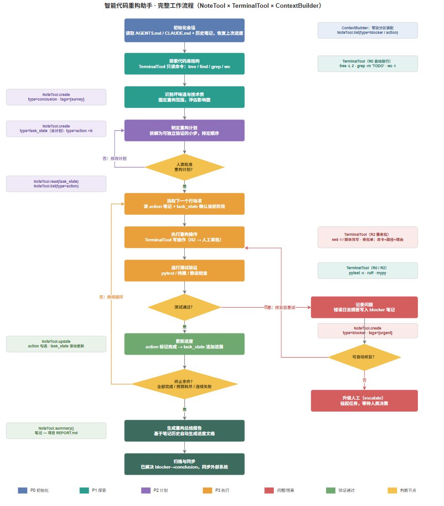

# 第九章习题：上下文工程与长时程任务管理

> **说明**：部分习题没有标准答案，重点在于培养对上下文工程和长时程任务管理的综合理解和实践能力。


| GSSC 阶段       | Claude Code                                          | Codex CLI                                   | Grok Build                                 | DeepSeek Harness                    |
| ------------- | ---------------------------------------------------- | ------------------------------------------- | ------------------------------------------ | ----------------------------------- |
| **Gather**    | CLAUDE.md 多层加载 + memory prefetch + 环境注入              | AGENTS.md 链式聚合 + session memory             | AGENTS.md 启动加载 + memory 检索 + 代码图           | "load allowed context" + 插件片段 + @文件 |
| **Select**    | 每轮装配线的取舍（microcompact 裁剪 + 触发压缩）                     | 合并大小上限 + 就近覆盖规则                             | token 预算跟踪 + Arena 选优                      | allowed 白名单 + 用户选分支                 |
| **Structure** | concat 顺序：default→append→agent→claudemd→memory→style | 固定插入序：permissions→developer→AGENTS.md→环境→提问 | prompt\_build.rs 三路合并成 ConversationRequest | 插件片段装配 + LLM seam 翻译                |
| **Compress**  | 三层递进压缩（~80% 触发）                                      | 两级压缩（~90% 触发）                               | token 跟踪 + 自动摘要                            | 插件挂载的 compaction                    |

select 的实现路径分化最大。 Gather/Structure/Compress 三家几乎雷同（阈值压缩、固定顺序装配、截断摘要），<b><font color=darkred>但 Select 出现了三条路线：自动打分裁剪（Claude）、预算+覆盖规则（Codex）、人机协同（DSH 的 ThoughtDAG 让用户选分支）+ 评估器驱动（Grok 的 Arena）</font></b>。Select 正是上一轮说的"优化重心从塞得下转向选得准"的战场——也是你们 RSI 动作空间所在的地方。


---

## 1. 上下文工程与提示工程的区别 ⭐⭐ 理论/分析

本章介绍了上下文工程与提示工程的区别。请分析以下问题：

### 1.1 上下文腐蚀现象

> 大上下文窗口解决的是"容量"问题，而上下文工程解决的是"效用"问题


在 9.1 节中提到「上下文必须被视作一种有限资源，且具有边际收益递减」。请解释：

- 什么是「上下文腐蚀」（context rot）现象？
  - answer: 上下文太长发生遗忘， 随着上下文窗口中 tokens 数量的增加，模型从上下文中准确回忆信息的能力反而下降这一现象
    - Transformer让每个token与上下文所有token建立关联，理论少形成O(n2)级别的两两注意力关系。上下文越长，模型对这些两两关系的建模能力就被拉薄，形成上下文规模与注意力集中度的天然张力
    - 模型注意力模式来自训练数据分布——短序列在训练中远比长序列常见，所有模型对全上下文依赖的经验更少、专门参数也更少
- 为什么即使模型支持 100K 甚至 200K 的上下文窗口，我们仍然需要谨慎管理上下文？
  - answer: 上下文是一种有限资源，且边际收益递减。

### 1.2 上下文加载策略对比

假设你要构建一个「代码审查助手」，需要分析一个包含 50 个文件的代码库。请对比以下两种策略，分析各自的优缺点和适用场景：

| 策略 | 做法 |
| --- | --- |
| ① 全量加载 | 一次性将所有文件内容加载到上下文中 |
| ② JIT 按需检索 | 使用 JIT（Just-in-time）上下文，通过工具按需检索文件 |

第一种方法显然上下文爆炸，出现上下文腐蚀  
第二种更加合适

### 1.3 系统提示的两个极端误区

在 9.2.1 节中提到系统提示的两个极端误区：「过度硬编码」和「过于空泛」。请各举一个实际例子，并说明如何找到合适的平衡点。

「过度硬编码」

例子：为一个客服智能体写系统提示时，把业务流程写成大段脆弱的 if-else 逻辑——
> "你必须把每个用户请求归类为以下意图之一：['incident_resolution', 'general_inquiry', 'order_resubmission', 'account_maintenance', 'requires_escalation']。如果是 incident_resolution，先问 3 个追问再调用 resolve 工具；如果是 general_inquiry，不要追问、一次性回答；如果用户请求中包含 order_id，则标记为 order_resubmission，除非用户满足以下 5/7 个条件……"
（这正是原书图 9.2 中 "too specific" 一列的示例。）

问题在哪：维护成本高、易碎。真实用户请求千变万化，枚举式的规则永远覆盖不全——一旦遇到规则之外的边界情况，模型要么机械执行错误分支，要么在几十条规则里"迷路"。改一条业务规则就要动提示词里的一堆分支，长期维护是一场噩梦。


误区二：过于空泛（Too vague）
例子：同一个客服智能体的另一种写法——
> "你是一个烘焙店助手，你应该以符合公司品牌精神和原则的方式解决客户问题。必要时升级给人工。"

问题在哪：缺少对期望输出的具体信号。模型不知道有哪些工具可用、不知道先了解完整情况再给方案、不知道什么情况该升级人工。"符合品牌精神"这种表述没有可执行的含义，等于把关键决策完全甩给了模型自由发挥。


---

## 2. GSSC 流水线 ⭐⭐⭐ 理论+实践

GSSC（Gather-Select-Structure-Compress）流水线是本章的核心技术。请深入思考：

> 💡 **提示**：这是一道动手实践题，建议实际操作。

### 2.1 阶段失效的影响分析

在 9.3 节的 ContextBuilder 实现中，四个阶段各有不同的职责。请分析：如果某个阶段失效（如 Select 阶段选择了不相关的信息，或 Compress 阶段过度压缩导致信息丢失），会对最终的智能体表现产生什么影响？

1. Garher失效（职责是记忆、RAG、对话历史、自定义包中多源汇集候选信息）
   1. 失效模式：某数据源检索失败但未被容错（书中代码用 try-except 兜底并打印 WARNING）；或 conversely 汇集过于贪婪，把大量低质信息全部塞入候选池。
   2. 这是不可逆的信息缺失——如果关键记忆/RAG 结果根本没进候选池，后续 Select 评分再高也救不回来，智能体会"凭空作答"或答非所问。
2. Select失效(Select 的职责是"相关性 + 新近性"加权打分 + 贪心填充。)
   1. 失效模式：选了不相关信息（如关键词重叠导致的假阳性——查询词碰巧命中但语义无关）；或漏选关键信息（min_relevance 阈值过高把重要内容过滤掉；时间戳错误导致新近性打分失真）。
   2. 这正是上一轮我们讨论的上下文腐蚀的工程成因——预算被无关 tokens 吃掉，关键信息的"注意力份额"被摊薄，模型在长上下文中回忆正确信息的概率下降。即使 Gather 汇入了正确答案，Select 漏选等价于没检索
3. Structure失效(按类型分组、拼装固定模板（`[Role & Policies] / [Task] / [State] / [Evidence] / [Context] / [Output]`）)
   1. 失效模式：类型分类错误（metadata 的 type 字段标注不当，把记忆错分为 evidence，或反之）；或分区顺序混乱——书中 Compress 按 \n\n 切分区做顺序保留，分区顺序直接决定压缩时的存活优先级。
   2. 信息的"位置信号"会误导模型——比如在 Claude 的语境下，系统指令和文档放错位置可能改变模型对信息权重的判断。这类失效很阴险：token 数没变、信息也没丢，只是组织方式错了，表现为"模型看到了却没用对"，排查时需要回溯整个分区拼装逻辑。
4. Compress失效
   1. 失效模式一：过度压缩导致信息丢失（题目举的例子）。书中实现是"顺序保留分区 + 超预算分区简单截断（_truncate_text）"。这意味着：排在后面的分区被整段丢弃。如果 `[Context]`（含记忆、对话历史）排在最后，截断后智能体丢失用户背景；由于压缩发生在上下文构建的最后一步，信息一旦丢失没有任何后续环节能补救，且往往是静默的（只有一条 WARNING 日志）。这正是 9.2.3 节压缩整合建议的对立面——书中明确说压缩应先优化召回再优化精度，而暴力截断是最不保召回的做法。
   2. 失效模式二：压缩不足。预算内硬塞所有分区，等于 Compress 形同虚设，退化成"Gather/Select 失控 + 无兜底"，直接触发 context rot。
   3. 级联放大：压缩是按分区顺序进行的，所以 Structure 阶段的排序错误会在 Compress 阶段被惩罚性放大——被错排到后面分区的高价值信息会被优先砍掉

### 2.2 上下文质量评估功能（动手实践）🛠️

[context_quality_evaluator](./context_quality_evaluator.py)

请基于 9.3.4 节的代码，为 ContextBuilder 添加一个「上下文质量评估」功能：在每次构建上下文后，自动评估上下文的信息密度、相关性和完整性，并给出优化建议。

自动评估上下文质量设计准则：
- 可追溯： 指标必须能追溯到具体信息包
- 三维度正交：相关性、密度、完整性各司其职 （`overall = 0.4×相关性 + 0.25×密度 + 0.35×完整性`）
  - 相关性：选进来的信息对不对（Select 阶段的质量） `relevance = 0.6 × mean_rel + 0.4 × query_cov`
    - mean_rel：入选非系统包的 relevance_score 算术平均（系统指令恒 1.0，排除防虚高）。分数来源即上面的 LLM/Jaccard
    - query_cov：查询覆盖率。_tokenize 把查询拆成词项（英文单词 + 中文相邻二元组，去停用词），统计这些词项出现在最终拼好的 context 字符串里的比例——衡量"查询的每个关键概念在上下文里是否有着落" 
  - 信息密度：token 的效用高不高（信号/冗余比，对应"上下文腐蚀"的防御） `density = signal × (1 − redundancy)`
    - signal 信号强度 = Σ(综合分ᵢ × tokenᵢ) / Σtokenᵢ，即 token 加权的平均综合分；综合分是 Select 排序用的 0.7×relevance + 0.3×recency，按 id() 从 scored 表查回。直觉：平均每个 token 承载多少有用信号（分母含系统包，系统指令越长稀释越狠——视为必须携带的开销）
    - redundancy：入选包两两 Jaccard 词重叠的均值（封顶 500 对防 O(n²)）。重复内容是"负密度"，乘 (1−redundancy) 惩罚
    - budget_util = used/budget 只展示不进公式
  - 完整性：该进的信息进没进来（Gather 召回 + 预算截断，对应不可逆损失） `completeness = 0.4 × source_cov + 0.3 × yield + 0.3 × trunc_term`
    - source_cov：|入选来源类型 ∩ 候选来源类型| / |候选来源类型|——memory/RAG/history/knowledge 各通道是否都有代表入选
    - yield：非系统入选数 / 非系统候选数——阈值过滤+预算丢弃合计丢了多少召回
    - trunc_term：只要 dropped_by_budget 非空（有高分包因装不下被丢）就直接给 0.3（重罚 0.7）；否则 retention = 1 − 压缩损失tokens/压缩前tokens（没触发压缩则为 1.0）。区分"整包没进上下文"（伤召回，重罚）和"进了但被压缩"（伤保真，轻罚）
- 评估零成本：不引入额外 LLM 调用
- 阈值可配 + 趋势监控：单次评分不如纵向比较
  - 绝对阈值（如 redundancy > 0.4）必然因任务而异，所以阈值应是类级别的可调参数；更有价值的是 趋势——builder.history 积累多次构建报告后，质量下降幅度（而非单次绝对值）才是最可靠的异常信号。这对应书中最佳实践第 4、5 条（监控日志、A/B 测试）：评估系统本身就是 A/B 测试的基础设施——没有它，调参就是盲调

趋势监控举例
单日视角：第 20 天 overall=0.76（B 级）、压缩损失 33 tokens——任何一次看都觉得"没问题"。
-  压缩损失 = 压缩前 token 数 − 压缩后 token 数 （只有在压缩 = 破坏性截断时这个指标才是有效的)
```
overall   斜率/天=-0.0030  基线漂移=-8%   → ✓ 正常（完全没报警！）
相关性     斜率/天=-0.0087  基线漂移=-27%  → 🚨 触发告警
压缩损失   斜率/天=+1.56    基线漂移=+637% → 🚨 触发告警
```

而趋势一旦报警，归因路径非常清晰：压缩损失 30 天增长 637% → 定位到知识库条目持续增加 → Select 阶段更早填满预算 → 结构化模板（[Role & Policies] 等分区头）叠加后超限 → Compress 触发。对应的修复动作（对历史消息预压缩、给 RAG 结果设独立子预算）能精确落到旋钮上。这也正好落地了书中最佳实践的第 4 条——"记录每次上下文构建的统计信息，便于后续优化"：历史报告 builder.history 就是这个趋势监控的数据源。


### 2.3 混合压缩策略设计

GSSC 流水线中的「压缩」阶段使用了 LLM 进行智能摘要。请思考：

- 在什么情况下，简单的截断（truncation）或滑动窗口（sliding window）策略可能比 LLM 摘要更合适？
- 设计一个混合压缩策略，结合多种压缩方法的优势。

answer:

> 前置认知（承接 2.2 压缩损失的讨论）：不同压缩机制的**损失模型完全不同**——截断的损失=被删内容、去重的损失=0、摘要的损失=有损但高保真。所以「哪种更好」不是全局问题，而是**按内容类型分治**的问题；也正因如此，单一指标（如 before−after 差值）不可能是通用的压缩质量度量。

#### Q1：什么时候截断 / 滑动窗口比 LLM 摘要更合适

LLM 摘要的固有代价：延迟（一次完整 LLM 往返）、token 成本、非确定性、**静默丢失关键细节**（数字/ID/代码会被转写错，且没有任何失败信号）。以下场景这些代价换不回收益：

| 场景 | 为什么截断/滑窗更优 |
| --- | --- |
| **要求逐字保真的内容**：待编辑的代码、JSON/SQL 工具输出、schema、路径/ID/哈希、法务引用、系统指令 | 摘要有损且可能幻觉——代码摘要出来没法改。截断保留下来的部分**保证原文**，丢的部分至少明确知道丢了什么 |
| **价值集中在尾部**：agent 对话历史、工具调用日志 | 最近 K 轮承载全部"当前状态"（任务、上次工具结果），老内容价值衰减极快。滑窗零成本拿走几乎全部价值，摘要的边际收益覆盖不了它的一次 LLM 往返 |
| **高频/实时路径**：每轮 agent loop、流式输出 | 摘要每轮加几百 ms~秒级延迟且烧钱；截断是微秒级字符串操作。Claude Code 的做法即：平时对旧工具输出硬截断，只在逼近窗口阈值时才触发一次 compaction |
| **确定性/可复现/可缓存**：测试、调试、审计、prompt cache | 摘要非确定 → 同输入不同上下文，破坏复现与前缀缓存；滑窗是纯函数。"上下文=最近 N 条原消息"可审计，"上下文=某模型某次的摘要"不可审计 |
| **溢出量很小**（如超预算 <5%） | 一次摘要调用的开销（读入全部+生成）比省下的还多，只值得截掉最低价值的 section |
| **内容本身已极密 / LLM 处理不好**：稠密表格、超长日志 | 摘要只能变差。日志的正确做法是 head+tail+正则抽关键行，不是摘要 |
| **不可信内容**（攻击者可控文本） | 对其跑摘要等于把它送进第二个 prompt（注入面扩大）；截断是惰性操作 |

**一句话判据**：这份内容「**是什么**」重要，还是「**说了什么**」重要？是什么（代码、数据、指令、引用）→ 逐字保留或丢弃；说了什么（背景、闲聊、旧探讨）→ 才轮到摘要。


#### Q2：混合压缩策略——级联压缩器（Cascade Compressor）

设计原则：**无损优先于有损、确定性优先于生成式、按内容类型分治、生成式只作升级手段且必须有确定性兜底**。每一级只在仍超预算时才进入下一级：

```
Structure 拼装后超预算？
│
├─ S0 无损去重 / 规范化            成本 0，零损失
│    内容哈希 / MinHash 去重复包（重复读的文件、重复的工具输出）
│    压空白、剥样板字段；同内容只存一次，其余替换为引用指针（内容寻址）
│
├─ S1 价值驱逐（"聪明的截断"）        成本 0
│    按价值分 w_r×相关性 + w_c×新近度 + 类型优先级，升序丢弃
│    —— 截断的位置由分数决定，而非由字符串位置决定
│
├─ S2 分通道滑窗 + 锚点              成本 0，逐字保真
│    对话:  最近 K 轮 verbatim + 最初 1-2 轮（任务定义锚点，利用首因效应）
│    代码:  当前编辑的函数 verbatim，其余只留签名轮廓（outline）
│    日志:  head + tail + 正则抽错误行，丢中段
│
├─ S3 LLM 摘要（升级手段）           只压缩 S1-S2 驱逐掉的"旧材料"，绝不碰操作尾部
│    · 摘要一次，按内容哈希缓存，后续轮次复用（摊薄成本）
│    · 抽取式优先（按查询相似度挑句子），再抽象式
│    · temperature=0，约束"数字/ID/代码逐字保留"，目标长度=剩余预算
│    · 带溯源指针（packet id），需要时可重新展开（重读文件/翻记忆）
│
├─ S4 校验（压缩后复评）             对应 2.2 的指标体系
│    查询覆盖率存活率 ≥ 阈值？结构完整（代码块闭合、无句中截断）？
│    不过关 → 回退 S2 的确定性截断
│
└─ S5 硬截断兜底                    永远保证预算合规的最终守门员
     任何 LLM 失败/超长输出，按 section 边界截断并加标记
```

**触发调度**（避免每轮都付摘要成本）：

- 溢出小（如 <15%）：只走 S0-S2，零 LLM 成本
- 溢出大或持续增长：升级到 S3
- 阈值式主动 compaction：上下文用到窗口 70% 时，**空闲时异步**预先压缩旧材料，不在请求关键路径上付摘要延迟（Claude Code 的 compaction 即此模式）
- 摘要按内容哈希缓存，文件被编辑才失效

**保护名单**（任何一级不得动）：系统指令、当前任务陈述、用户最新消息、最近一次工具结果。

**各取所长**：去重拿 *无损*、滑窗拿 *零成本+逐字保真+新近性*、评分驱逐拿 *确定性*、LLM 摘要拿 *语义密度+长程记忆*、硬截断拿 *预算合规的绝对保证*。

**与本章实现的映射**：书中 9.3.4 的 `_compress`（顺序保留分区+超限截断）只相当于 S5 兜底；`Select` 阶段的综合分排序本质上是 S1。所以把 GSSC 的 Compress 升级为混合策略，不是替换而是**在 Select 与现有截断之间插入 S0/S2/S3 三级**，并让 S4 复用质量评估器——`redundancy`（`_mean_pairwise_overlap`）驱动 S0 的去重阈值，`_combined_score` 就是 S1 的价值分，查询覆盖率前后对比就是 S4 的存活率校验。

**实现**：[context_quality_evaluator.py](./context_quality_evaluator.py) 的 `HybridCascadeContextBuilder`（demo 场景 4）。实测：`--no-llm` 走确定性路径 `S0→S1→S2`；LLM 开启时 `S0→S1→S2→S3→S4`（摘要回收 3 包，覆盖率存活 1.00，完整性 0.64→0.74）。级联参数全部是类属性旋钮（`DEDUP_JACCARD / EVICT_BAR / HISTORY_KEEP_LAST / SURVIVAL_MIN` …），Trace 记录各级触发情况。

落地时对设计稿的一处修正：**S3 的语义从「仍超预算时的升级手段」修正为「摘要回收」**——用 S0-S2 省出的预算（slack）把被逐内容以摘要形式带回，绝不超预算。原因：本流水线中 Select 已把选中集裁到预算内，Compress 的溢出上限 = 结构开销 − reserve（约 40 tokens），确定性驱逐收敛后剩余预算极小，"仍超预算时再摘要"装不回去；而"省出预算回收摘要"才是 Claude Code compaction 的实际语义——近期 verbatim + 旧材料摘要化，两者并存于同一预算内。


---

## 3. NoteTool 与 TerminalTool 扩展实践 ⭐⭐⭐ 实践/设计

NoteTool 和 TerminalTool 是支持长时程任务的关键工具。基于 9.4 节和 9.5 节的内容，请完成以下扩展实践：

> 💡 **提示**：这是一道动手实践题，建议实际操作。

### 3.1 笔记自动整理机制

NoteTool 使用了分层笔记系统（项目笔记、任务笔记、临时笔记）。请设计一个「笔记自动整理」机制：当临时笔记积累到一定数量时，智能体能够自动分析这些笔记，将重要信息提升为任务笔记或项目笔记，并清理冗余内容。

### 3.2 安全机制与人机协作审批

TerminalTool 提供了文件系统操作能力，但在 9.5.2 节中强调了安全性设计。请分析：

- 当前的安全机制（路径验证、命令白名单、权限检查）是否足够？
  - answer: 教学级够用，生产级不够
- 如果智能体需要访问敏感文件或执行危险操作，应该如何设计一个「人机协作审批」流程？
   - 核心原则：模型只能申请权限，永远不能批准权限


1. 风险分级（确定性代码判定，不让模型自评）
```
R0 自动放行  白名单命令 + 路径解析后确认在 workspace 内 + 非敏感路径
R1 自动放行+记录  同上，但命中"敏感读取"清单（.env、*.pem、.ssh/、credentials、
                  package-lock 外的 lock 文件）→ 内容脱敏（mask 值）后进入上下文
R2 需人工审批  白名单外命令 / 白名单内带写参数（sed -i、重定向、-exec、system()）
              / 路径解析落在 workspace 外 / 敏感文件原始内容读取
R3 默认拒绝    不可逆操作（rm、git push --force）、网络命令、批量操作（通配符+写）
```

2. 审批流程（挂起 → 申请 → 授权 → 执行 → 审计）
```
Agent: 需要 cat .env 以排查配置问题
   │
   ▼ TerminalTool 检测到 R2
挂起该工具调用，生成审批单：
  ├─ 原始命令 + 解析后的绝对路径列表
  ├─ 来源：哪个文件哪一步（traceback / 计划步骤）
  ├─ 模型自述理由："需要确认数据库连接串以诊断连接失败"
  ├─ 影响面：只读 / 预计输出大小
  └─ 建议：风险等级 R2·敏感读取
   │
   ▼ 推送给人类（CLI 弹窗 / Web UI / IM 机器人）
人类选项：
  [a] 允许一次      [b] 允许且本会话内同类豁免（记住 scoped 授权）
  [c] 拒绝并告知原因 [d] 修改后执行（人类改写命令，如改为 cat .env | grep DB_HOST）
  （默认超时=拒绝；后台静默超时阈值远小于交互超时）
   │
   ▼ 授权是"有界 capability"，不是布尔值
   {scope: 路径级/命令级, 时效: 单次|会话, 脱敏: 是否 mask 值}
   │
   ▼ 执行 + 全程审计日志（可用 NoteTool 落盘，天然可 Git 追溯）
```

| 层  | 机制                              | 强度                       |
| -- | ------------------------------- | ------------------------ |
| L1 | 提示层规则（"不要读敏感文件"）                | 仅建议，可被注入覆盖               |
| L2 | 应用层：白名单+解析+R0–R3 分级             | 强制，但与应用同进程，可被 exploit    |
| L3 | **OS 层**：容器/只读挂载/seccomp/独立低权用户 | 真正兜底——即使 L2 有洞，文件系统本身不答应 |
| L4 | 人工审批                            | 覆盖 L1–L3 都拦不住的"合理但危险"请求  |


### 3.3 智能代码重构助手

结合 NoteTool 和 TerminalTool，设计一个「智能代码重构助手」：能够分析代码库结构、记录重构计划、逐步执行重构操作，并在笔记中追踪进度和遇到的问题。请画出完整的工作流程图。

1. P0 初始化-读取AGENTS.md + 历史笔记，恢复上次的进度 
2. P1 探索-探索代码结构 -> 识别bug和技术债固定重构范围、评估影响面
3. P2 计划-制定重构计划-拆解为可独立验证的小步 -> 人类审批重构计划
4. P3 执行-读取下一个行动项 -> 执行重构操作 -> 运行测试验证 -> 测试是否通过
5. 问题&阻塞 -> 问题记录 -> 可自动修复 -> 升级人工
6. 验证通过 - 更新进度 action 标记完成-> task_state追加进展
7. 终止条件 ： 全部完成 | 预算耗尽 | 连续失败
8. 生产重构总结报告 - 归档


---

## 4. 长时程任务管理案例分析 ⭐⭐⭐ 设计/分析

在 9.6 节的「长时程任务管理」案例中，我们看到了上下文工程在实际应用中的价值。请深入分析：

### 4.1 分层上下文管理的协调

案例中使用了「分层上下文管理」策略：即时访问（TerminalTool）+ 会话记忆（MemoryTool）+ 持久笔记（NoteTool）。请分析：

- 这三层之间应该如何协调？

| 维度   | TerminalTool（即时层） | MemoryTool（会话层） | NoteTool（持久层） |
| ---- | ----------------- | --------------- | ------------- |
| 数据形态 | 原始文件/命令输出         | 半结构化条目          | 人类可读 Markdown |
| 时效性  | **永远新鲜**（JIT 现取）  | 中等（会话内漂移）       | 有陈旧风险（跨天/周）   |
| 寿命   | 无状态               | 会话              | 跨会话、可 Git 化   |
| 写者   | 环境（客观事实）          | Agent 自动写入      | Agent + 人类共写  |
| 访问成本 | 高（每次工具调用）         | 低（检索）           | 低（整载/检索）      |
| 容量   | 无限（源码库）           | 有限              | 有限            |

协调的核心是一条单向的蒸馏流： 信息只允许从下层想上层蒸馏（raw->distilled），上层不复制下层内容、只保存指针。这和Claude Code harness的做法同构——它的装配线里 claudemd_layers 与 memory_sections 是分来的2段，工具结果从不进入常驻分渠，缠住分区也从不复制工具结果

```
TerminalTool ──蒸馏──▶ MemoryTool ──沉淀──▶ NoteTool
   (原始事实)    (会话内中间产物)    (决策/计划/结论)
        ◀────── 指针引用，不复制 ──────▶
```
2个反向机制  
1- 选择性下沉：一条信息 -> NoteTool 需要过三问 ———— 跨会话还会用么？内容稳定么？人类需要审核么？三问有一否定，就留在memortTool 随会话消亡  
2- 选择性上浮：NoteTool内容进入每轮上下文前，凡是引用文件状态的地方，用terminalTool做一次轻量核对（`git log -1 --format=%H -- path` 比对笔记里的 `commit hash`）——陈旧笔记要么刷新要么打 stale 标记。  

- 什么信息应该放在哪一层？ 
  
| 信息类型             | TerminalTool | MemoryTool | NoteTool             | 理由                     |
| ---------------- | ------------ | ---------- | -------------------- | ---------------------- |
| 文件原始内容、函数实现      | ✅ 只在此        | ❌          | ❌ 只存路径+行号区间          | 内容会变，存了就陈旧             |
| grep/测试的中间输出     | 用完即弃         | ✅ 短期缓存     | ❌                    | 只服务当前任务链               |
| 当前任务目标、计划        | ❌            | ✅          | ✅ task\_state        | 会话内双写，跨会话以笔记为准         |
| 决策与理由、blocker、结论 | ❌            | ❌          | ✅ conclusion/blocker | 需要人类可读、可审计             |
| 项目约定、API 契约      | ❌            | ❌          | ✅ reference          | 稳定、需版本管理（tags=\[v1.0]） |
| 待办行动项            | ❌            | ❌          | ✅ action             | 跨会话续接的锚点               |
| 凭证、密钥            | ❌            | ❌          | ❌                    | 哪层都不该放（上一轮的 R3）        |

三条硬规则  
1- TerminalTool 是唯一事实原，其余两层都是观点源——凡是可以重新查到的（代码、配置、git状态），任何时刻都以重查为准，笔记和记忆里只存“哪里查”不存“查什么”  
2- MemoryTool 只存过程，NoteTool只存结论——中间产物（检索结果、试错记录）寿命等于会话；决策、计划、问题及其解决，寿命等于项目  
3- 笔记五中类型构成闭包：task_state(阶段)、action(下一步)、blocker(阻塞)、conclusion(结论)、reference(参考)——任何信息都能归入其一，归不进去说明它不该进入持久层

- 如何避免信息冗余和不一致？

> 本质是同一个问题的两面：同一事实存在2个副本，然后一个变了

四条纪律：  
1- 单一事实源+指针代替复制。笔记引用永远写笔记引用代码时永远写 path:line-range @commit-hash，而不是贴代码片段。例外只有一种：结论性摘要（"该模块职责是 X"）——摘要与原文的偏差正是笔记的价值所在，这类偏差靠第 4 条兜底。  
2- 写权限分层。三层写者不同就是天然的一致性防线：MemoryTool允许agent自由写（错了代价低，会话结束清零）；NoteTool允许agent写 task_state/action/blocker，但 conclusion/reference的关键条目走9.4.5最佳实践第四条的“关键阶段人工审核”；项目约定类文件（等价于AGENTS.md)人类独占写权，agent提PR而非直接改。写权越上层越收紧，不一致的风险就随寿命被逐级过滤  
3- 版本与陈旧标记。笔记带tags+时间戳；引用外部文件的内容带commmit Hash。 9.4.5的清理归档（已解决blocker -> conclusion 过时action删除）不是可选项，是每层健康度的前提——清理动作本身也应是一条action笔记，否则清理笔记这件事会被遗忘。  
4- 定期对账 + 矛盾上报。每个工作阶段结束（或ContextBuilder 的压缩触发点) 做一次三层对账：笔记结论 vs 终端现实（抽hash核对）、笔记之间（新conclusion与旧 reference 是否矛盾)、会话记忆vs笔记(agent 记忆里如果还留着已被推翻的临时结论，删掉)。发现矛盾不要自己解决——矛盾本身就是最高优先级的blocker笔记，上报人类。原因：三层不一致时，错误几乎一定在"最旧的那一层“（笔记），而agent没有能力判断哪份旧笔记是故意保留的历史记录还是忘改的过期结论——这个判断需要人类。


举例：
1. P1 探索：`grep -rn "TODO"` 的原始输出 -> 只在终端/会话记忆里，**不存笔记**；蒸馏出的结论("三个模块职责混乱") -> `conclusion`  笔记，引用路径
2. P2 计划： task_state + action笔记落地；**不写记忆** （计划必须持久化）
3. P3 执行：测试报错原文 -> 会话记忆；摘要（错误本质+尝试） -> `blocker`笔记：修复后测试通过 -> blocer改写conclusion (标注 commit)
4. 下一轮会话： ContextBuilder 从NoteTool装载task_state + 未解决blocker (不从 MemoryTool —— 上一轮会话已死)，对引用文件做hash核对，发现`auth.py` 已被人改过 -> 打stale标记不能过在新blocker里上报


**终端管"现在是什么样"，记忆管"这一路试了什么"，笔记管"我们决定了什么"——下层永远是上层的证据，上层永远是下层的索引，谁复制谁负责，谁矛盾谁上报**


### 4.2 断点续传机制设计

> 修正后的分层很干净：session 全量文件是唯一事实源，恢复=装载+必要时 GSSC，笔记降级为跨会话知识与审查点。中断策略的全部巧思，都花在"断点模糊性的局部消解"上——每条策略都在做同一件事：把不确定的中断时刻，压缩成"一步范围内可验证的确定性问题"，验证不了就上报，绝不猜。

假设任务执行过程中发生了中断（如系统崩溃、网络断开），智能体需要从笔记中恢复状态并继续执行。请设计一个「断点续传」机制：

- 如何在笔记中记录足够的状态信息？
- 如何验证恢复后的状态是否正确？

```
session 文件（全量历史，ground truth，只增不删）
   │
   ├─ 会话内/恢复时：全部装载 ──超长──▶ GSSC/压缩 ──▶ 发给 LLM 的上下文
   │
   └─ NoteTool：跨会话的知识沉淀 + 人工审查点（不是恢复主路径）
```

#### 中断恢复

| # | 中断类型                  | 断在哪            | 一句话策略                                        | 恢复动作                                            |
| - | --------------------- | -------------- | -------------------------------------------- | ----------------------------------------------- |
| 1 | **流式输出中断**（网络闪断）      | LLM 说话说到一半     | 截尾到最后一条完整消息，续传不重发                            | 丢弃半截消息 → `previous_response_id` 接着生成            |
| 2 | **工具执行中断**（崩溃/断电）     | 命令/测试跑到一半      | 只验"在途这一步"，不验全库                               | 看重灾区文件 diff + 重跑该步的验证命令；命令本身可续（`pytest --lf`）最好 |
| 3 | **意图未确认**（请求已发不知成败）   | 副作用操作发出后、结果未落盘 | 先查真实状态，绝不盲目重试                                | 去外部系统查一次 → 补发或跳过                                |
| 4 | **压缩中中断**             | 摘要写到一半         | 压缩是可回滚的派生操作                                  | 丢弃半成品摘要，用原始 session 重来                          |
| 5 | **人为打断 + 新指令**        | 任意位置           | **停 → 决 → 封 → 转**：先停干净，旧任务封存移出上下文，新指令带着优先级注入 | 急停工具进程 → 现场默认保留 → 旧任务打 `paused` → 新任务开跑         |
| 6 | **人为打断 + 无新指令**（临时走开） | 任意位置           | 同 5，只是不注入新任务                                 | 同 5，稍后说"继续"即解封                                  |

记忆口诀：
- 技术类（1–4）：目标是"回断点"——先确定断在哪，再局部验证，验证不了就查、就重跑这一步，绝不猜。
- 人为类（5–6）：目标是"换轨道"——旧意图必须显式封存（从上下文降级到笔记），否则新旧目标在上下文里打架。
- 通用底线：停止要向下传播（模型层取消不够，工具进程也要杀）；恢复要向上汇报（停在哪、留了啥、接下来干嘛）。

背后统一的原理：   
所有六类的处置都是同一件事：把不确定的断点，压缩成"一步范围内可验证的问题"；验证不了就上报人类，绝不猜。


### 4.3 任务依赖管理系统

长时程任务往往涉及多个子任务的并行或串行执行。请设计一个「任务依赖管理」系统：

- 能够表达任务之间的依赖关系（如「任务 B 必须在任务 A 完成后执行」），并自动调度任务执行顺序。
- 这个系统应该如何与 NoteTool 集成？

依赖模型：DAG 就建在笔记上
```json
{
  "type": "action",
  "id": "act-07",
  "content": "将 UserRepo 的 SQL 逻辑提取到 UserDAO",
  "deps": ["act-05"],              // 完成依赖：act-05 done 后我才 ready
  "mutex_keys": ["src/repo/user_repo.py"],  // 互斥资源：同 key 的任务不得并行
  "verify_cmd": "pytest tests/test_user_repo.py -x",
  "status": "pending"               // pending | ready | running | done | blocked
}
```

| 关系                  | 表达              | 机制       |
| ------------------- | --------------- | -------- |
| **完成依赖**（B 必须在 A 后） | `B.deps = [A]`  | 拓扑约束     |
| **并行**（无依赖）         | 无边              | 就绪队列同时出队 |
| **互斥**（改同一批文件，不能并行） | `mutex_keys` 相同 | 资源锁，串行化  |

task_state 笔记记录全局调度视图（调度器每次重建，只是缓存加速）：
```json
{ "type": "task_state", "schedule": {
    "ready": ["act-07"], "running": ["act-03"],
    "done_count": 6, "total": 12,
    "critical_path": ["act-07","act-09","act-11"] } }
```

调度器：无状态、事件驱动、可重建
- 核心设计决策：调度器不拥有任何状态。全部的输入就是 NoteTool.list(type=action) ——每次调度都从笔记重建DAG 
  - 奔溃恢复免费：调度器死了重启，扫一遍笔记就知道该干什么——不需要保存调度状态
  - 人类可直接改图：手动编辑某条action的deps, 下次调度自动生效——DAG是可审计、可Git化的

调度循环（事件驱动，每完成一个任务触发一轮）：
```python
def on_task_completed(task_id):
   note = note.update(task_id, status='done')
   graph = build_dag(note.list(type='action'))
   ready = [t for t in graph if t.status == "pending"
            and all(d.status == "done" for d in t.deps)]   # Kahn：入度清零
   for t in sort_by_critical_path_first(ready):            # 关键路径优先
      if all(mutex_free(k) for k in t.mutex_keys):      # 资源锁检查
         mutex_acquire(t.mutex_keys)
         notes.update(t.id, status="running")            # 写回笔记
         dispatch(t)                                     # 交给执行循环


def on_task_failed(task_id, error):
   blocker = notes.create(type='blocker', content=error, tags=[task_id])
   cascade = transitive_dependents(task_id) # 失败沿依赖反向传播
   for t in cascade:
      note.update(t.id, status='blocked')  # 不删除，标记等待
   
   escalate(blocker) # 不猜，上报人工

```
关键语义
1. 失败是传播的不是删除的——A 失败，依赖它的 B/C/D 标记 blocked 而不是消失；A 修复后它们自动恢复 ready。这保证失败从不造成"任务蒸发"。
2. 互斥是调度约束不是依赖——同 mutex_key 的两个无依赖任务，拓扑上可并行，但调度器串行派发；锁在任务完成（而非开始）时释放。
3. 循环依赖检测在写边时做——add_task 时跑一遍拓扑排序，发现环立即拒绝并报错位置（环无法自动消解，这是用户的计划错误，上报）。绝不让环进入调度。


与NoteTool的集成点

1. 笔记类型完全复用，零新增：`action`(任务节点)、`task_state`(全局视图)、`blocker`(失败传播终点)、`conclusion`（完成证据）
2. ContextBuilder 是调度器和执行循环之间的桥：每轮构建上下文时，把`ready ∪ running ∪ 未解决 blocker` 作为 `Evidence/Context`分区注入（按我们之前做的质量评估，这几类的相关性分数天然最高），blocked 和 pending 的不注入——上下文里只放"此刻可行动的"，这是防止长任务上下文膨胀的关键。
3. 动态扩图：执行中常发现计划外的新任务（"改了 DAO 才发现 Service 层也要动"）。支持 `add_task(deps=[当前任务])` 边执行边扩 DAG——这是 DAG 相对静态计划表的本质优势，也是计划必须拆成 action 笔记而非写死在提示词里的原因。
4. 依赖的"重验"：依赖的语义是"A 完成了"还是"A 的成果还在"？文件可能被外部修改。给关键依赖加 reverify_cmd：调度 B 前重跑一次 A 的验证命令，不过则 A 视为未真正完成。这把"依赖"从静态关系升级为可验证关系。


示例：
```
act-01 探索代码库 ──▶ act-04 提取 UserDAO ──┬──▶ act-07 改 Service 层 ──▶ act-09 全量回归
act-02 补缺失测试 ──▶ act-05 DAO 单元测试 ─┘         （mutex: service.py 与 act-08 互斥）
act-03 搭建 CI ────────────（与 01/02 并行，无依赖）

t0: 01,02,03 入度清零 → 三个并行
t1: 01 done → 04 ready；02 done → 05 ready → 04,05 并行
t2: 04 done → 07 ready；但 07.mutex(service.py) 与 08 冲突 → 排队
t3: 07 done → 09 ready → 跑全量回归
   若 05 失败 → blocker 上报，07/09 标记 blocked，01/02/03/04 的成果全部保留
```
---

## 5. 渐进式披露 ⭐⭐ 理论/设计

本章多次提到「渐进式披露」（progressive disclosure）的概念。请思考：

### 5.1 应用场景设计

在 9.2.2 节中，渐进式披露被描述为「每一步交互都会产生新的上下文，反过来指导下一步决策」。请设计一个具体的应用场景（如学术论文写作、复杂问题调试），展示渐进式披露如何帮助智能体更高效地完成任务。


提炼：渐进披露的三条操作纪律  
这个案例里每一步都在执行同样的三个原则：  
1. 最小充分披露：每一步只取"裁决当前假设所需的最小信息"——第 1 步取热力图而非日志，第 3 步取 300 行而非 40 万行；
2. 假设驱动裁剪：每步的披露范围由"上一步披露所生成了什么假设"决定——披露不是被动浏览，是主动实验设计；
3. 验证闭环：假设从不通过继续推理来强化，只通过设计新的披露来裁决——第 4 步的探针实验就是"披露"被用作实验工具。  

映射回三个组件：TerminalTool 是披露的执行器（每一次 JIT 取数）、ContextBuilder 是披露物的装配工（每步把新披露物按相关性放入，旧披露物按仍旧关键与否保留或降级）、NoteTool 沉淀的是"披露的结论"而非披露物本身（"根因是 coupon 路径连接泄漏"进笔记，1 小时的探针日志不进）。一句话：让模型自己决定看什么，但让它为每一次"看"付出一个可检验的假设作为代价——这就是渐进式披露比全量披露高效的机制本质。


### 5.2 探索引导机制

渐进式披露的一个潜在风险是「探索效率低下」：智能体可能会在不重要的细节上浪费时间，或者错过关键信息。请设计一个「探索引导」机制：通过启发式规则或元认知策略，帮助智能体更聪明地决定「下一步应该探索什么」。


元认知机制：让探索过程可自我观察
1. 探索日志（带预期的披露）——每条TerminalTool 调用强制附带元数据，写入NoteTool:
```
[J-015] 查询: i-03 错误码聚合（窗口 14:00-15:00）
        预期: 若连接泄漏，应看到 pool timeout 占比 >50%
        实际: 92%  · 假设 H1(泄漏) 置信度 0.4→0.7
```
2. 假设薄持久化——假设薄是笔记（`type=task_state`的扩展块或独立notes), 每次披露后更新它进入每轮的ContextBuilder 装配： 模型每轮开场都"看见"自己在想什么，而不是只在注意力里若隐若现。这是元认知的物质基础——工作记忆外化。
3. 周期step-back——每5步探索，强制一次不进工具的空转轮：只读假设薄 + 覆盖矩阵 + 日志，产出一段“当前证据图”评估（哪些假设还活着、盲区在哪、预算还剩多少、建议的下一步），再继续。这对应人类调试中的“离开屏幕走一圈”
4. 效率信号闭环——复用之前的质量评估器：探索轮次的相关性均分持续下滑（<0.4) = 在噪声里打转的量化信号，自动触发stuck熔断；dropped_by_budget 增长=探索产物挤占任务上下文，提示收紧披露力度

集成图：
```
ContextBuilder 每轮注入: [假设簿 + 覆盖矩阵 + 最近3条探索日志]  ← NoteTool
       │
执行循环: score(候选探索) = 区分力/成本
       │
TerminalTool: 每条调用带 {假设id, 预期结果} → 写探索日志
       │
NoteTool: 假设簿更新(增强/排除/新增) → 触发规则引擎(A/B/C组)
```

探索引导的机制本质，是把渐进式披露从"看到什么想什么"升级为"带着假设图去看"：假设簿让不确定性显式化，区分力规则让每一步都旨在裁决而非浏览，熔断与反证规则让惯性可被系统打断——探索的质量，最终取决于它消除的是哪个假设的哪部分不确定性；说不清这一点的探索，就是浪费


### 5.3 两种上下文策略的适用边界

对比「渐进式披露」与传统的「一次性加载所有上下文」：

- 在什么类型的任务中，前者有明显优势？
  - 生产环境故障排查(诊断类)
    - 为什么赢：关键信息不可预知——在查到错误码聚合之前，没人知道该看连接池还是 GC 日志；数据源是 TB 级日志，物理上装不下。一次性加载要么截断（关键线索可能被砍掉），要么压缩到失真。而渐进披露的每一步都依赖上一步的发现（症状→聚类→错误码→代码→验证实验），不存在"预先加载"的可能性。
     - 反例验证：全量加载 5 亿行日志 = 99.9% 是干扰项，正中 context rot 的下怀——主题相关但事实无关的内容恰是退化最严重的诱因。
   -  文献综述 / 深度调研（检索-综合类）
      - 为什么赢：相关性只能在阅读过程中定义——初始查询词("context engineering")指向的文献，读到第三篇才发现真正该追的是"context rot"这条线。一次性把 200 篇摘要塞进去，等于用最初的、最不准的判断锁定了视野；渐进披露让检索词随理解演化。
   - 共同特征：信息空间 ≫ 上下文窗口；任务路径是探索出来的而非预先规划的；每步的下一步由本步发现决定。
- 在什么类型的任务中，后者可能更合适？
  - 代码审查 / Diff 评审（全局耦合类）
     - 为什么赢：变更可枚举且边界清晰（一个 PR 的 diff 通常几千行，装得下）；正确性恰恰取决于全局视野——改了签名是否破坏了远处某个调用点、测试是否漏改了断言，需要"全部相关代码同时在场"才能看出跨文件的耦合。渐进披露在这里反而有风险：先读的文件形成的假设，可能污染后读文件的判断（锚定），而一次性在场时模型能直接看到矛盾。
     - 注意：这只对"装得下"成立；巨型 monorepo 的全量评审同样被迫走渐进路线。
   - 合同/法律文书审查（确定性合规类）
     - 为什么赢：两份理由。其一，引用必须逐字精确——"第 7.3 条与第 12.1 条矛盾"这类结论要求原文全在场，任何摘要/截断都引入合规风险；其二，完备性可枚举——审查清单（条款类型、风险点）是事先知道的，不存在"查到什么才决定看什么"。用检索过滤条款 = 用模型替律师承担了"哪些条款相关"的法律责任，不可取。
   - 结构化数据问答 / BI 报表（低延迟交互类）
     - 为什么赢：schema 小（几十张表的关系 + 业务口径，几 K tokens），问题之间无探索依赖（"上季度华东区毛利"和"本月退货率"共享同一份上下文），一次性常驻后每个问题零装载延迟。渐进披露每问一次先检索 schema，是纯开销——它的收益来自"减少无关信息"，但这里几乎没有无关信息可减。

共同特征：信息可枚举、装得下、全局耦合强；结论的正确性依赖"所有相关物同时在场"；且往往是多轮复用同一份上下文（交互式场景），摊薄了加载成本。


| 信号                   | 偏向         |
| -------------------- | ---------- |
| 数据源 ≫ 窗口（日志/代码库/文献库） | 渐进披露       |
| 任务路径依赖探索发现           | 渐进披露       |
| 信息会随时间变化（生产环境）       | 渐进披露       |
| 全集可枚举且 < 窗口的 50%     | 一次性加载      |
| 结论需要跨片段精确引用/全局一致性    | 一次性加载      |
| 多轮交互复用同一上下文          | 一次性加载      |
| 合规要求完备性（不漏比不错更重要）    | 一次性加载 + 人审 |


> 一次性加载的是"确定相关的核心"，渐进披露的仍是"开放问题".  
> 当任务的信息可以事先圈定边界时，把边界内的全部一次性加载；当边界本身需要探索才能画出时，渐进式披露是唯一选择。
