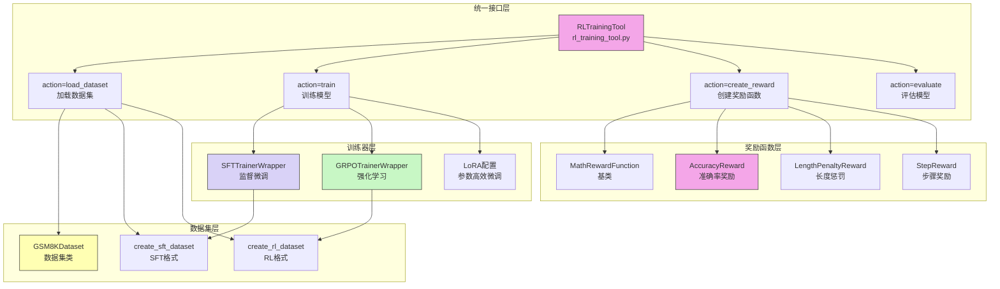
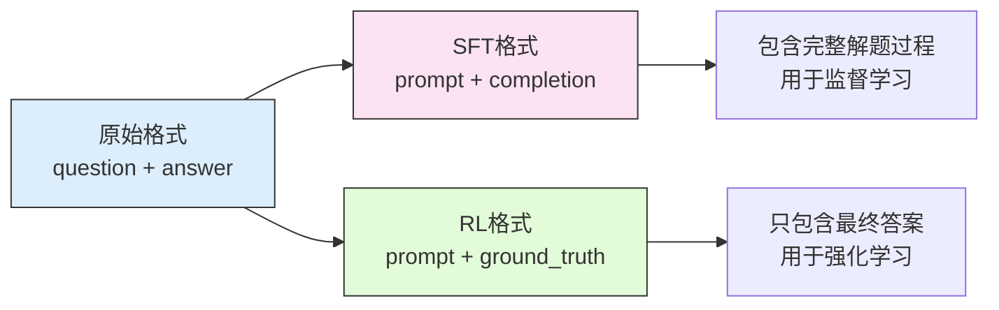
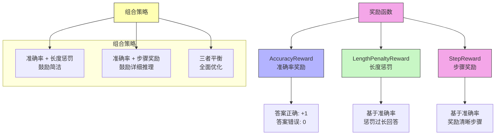

> 如何让智能体具备更强的推理能力?如何让智能体学会更好地使用工具?如何让智能体能够自我改进?


## 11.1 从LLM训练到Agentic RL 


### LLM训练全景
1. pretrain: $\mathcal{L}_{pretrain}=-\sum_{t=1}^{T} log P(x_t|x_1, x_2, ..., x_{t-1}; \theta)$
2. 后训练
   1. SFT(Supervised Fine-Tuning) 让模型学会遵循指令和对话格式: $\mathcal{L}_{SFT}=-\sum_{i=1}{N}log P(y_i|x_i;\theta)$
      1. 训练数据（prompt, completion）对
      2. SFT 的特点是数据量较小、需要人工标注、快速见效、主要学习任务格式和基本能力
   2. 奖励建模RM(Reward Model) SFT 后的模型虽然能遵循指令，但生成的回答质量参差不齐。我们需要一种方式来评估回答的质量，这就是奖励模型的作用。奖励模型的训练目标是学习人类的偏好：$\mathcal{L}=-\mathbb{E}[log \sigma{(r_{\phi}(x, y_w) - r_{\phi}(x,y_l))}]$
      1. 其中 $r_{\phi}(x,y)$ 是奖励模型，输入是(提示，回答)对，输出是质量分数; $y_w$ 是更好的回答(chosen)，$y_l$ 是更差的回答(rejected)，σ 是 sigmoid 函数，目标是让奖励模型给更好的回答更高的分数
      2. 训练数据是偏好对比数据，包含同一个问题的两个回答,一个更好(chosen),一个更差(rejected)。
   3. 强化学习微调，让他生成更好质量的回答
      1. 经典PPO: $J_{PPO} = \mathbb{E}_{x, y \sim \pi_\theta}[r_{\phi}(x, y) - \beta \cdot D_{KL}(\pi_\theta || \pi_{ref})  ]$
         1. 这个目标函数的含义是:最大化奖励，同时不要偏离原始模型太远
         2. $\pi_\theta$ 是当前策略，即语言模型; $\pi_{ref}$是参考策略，这个场景下可以是 SFT 模型

为了降低成本，研究者提出了 RLAIF(Reinforcement Learning from AI Feedback)[7]，用强大的 AI 模型(如 GPT-4)来替代人类标注员。RLAIF 的工作流程是:用 SFT 模型生成多个候选回答，用强大的 AI 模型对回答进行评分和排序，用 AI 的评分训练奖励模型，用奖励模型进行强化学习。实验表明，RLAIF 的效果接近甚至超过 RLHF，同时成本大幅降低


### Agentic RL的核心理念

传统的后训练(我们称之为 PBRFT: Preference-Based Reinforcement Fine-Tuning)主要关注单轮对话的质量优化:给定一个用户问题，模型生成一个回答，然后根据回答的质量获得奖励。这种方式适合优化对话助手，但对于需要多步推理、工具使用、长期规划的智能体任务来说，就显得力不从心了。

Agentic RL则是一种新的范式，它将 LLM 视为一个可学习的策略，嵌入在一个顺序决策循环中。在这个框架下，智能体需要在动态环境中与外部世界交互，执行多步行动来完成复杂任务，获得中间反馈来指导后续决策，优化长期累积奖励而非单步奖励。


从目标函数来看
- PBRFT: $\mathcal{J}_{PBRFT}(\theta)=\mathbb{E}_{s_0, y \sim \pi_\theta}[r(s_0, y)]$
- Agentic RL 最大化累计折扣奖励: $\mathcal{J}_{Agentic}(\theta)=\mathbb{E}_{\tau \sim \pi_\theta}\left[\sum_{t=0}^{T}\gamma^t r(s_t, a_t)\right]$


目标是赋予LLM智能体6大核心能力
- 推理 Reasoning
- 工具使用 Tool Use
- 基于 Memory
- 规划 planning
- 自我改进 Self-Improvement
- 感知 Perception


### Agentic RL设计

集成TRL (Transformer Reinforcement Learning)框架，模型选择Qwen3-0.6B。




- 数据集层
  - `GSM8KDataset`类
- 奖励函数层
  - 包含MathRewardFunction基类、AccuracyReward准确率奖励、LengthPenaltyReward长度惩罚、StepReward步骤奖励
- 训练器层
  - 包含SFTTrainerWrapper和GRPOTrainerWrapper，负责具体的训练逻辑和 LoRA 支持
- 统一接口层
  - RLTrainingTool统一训练工具，支持四种操作:`action="train"`(训练模型)、`action="load_dataset"`(加载数据集)、`action="create_reward"`(创建奖励函数)、`action="evaluate"`(评估模型)。

```python
import sys
import json

from hello_agents.tools import RLTrainingTool

# 创建RL训练工具
rl_tool = RLTrainingTool()

# 1. 快速测试:SFT训练(10个样本，1个epoch)
sft_result_str = rl_tool.run({
    "action": "train",
    "algorithm": "sft",
    "model_name": "Qwen/Qwen3-0.6B",
    "output_dir": "./models/quick_test_sft",
    "max_samples": 10,      # 只用10个样本快速测试
    "num_epochs": 1,        # 只训练1轮
    "batch_size": 2,
    "use_lora": True        # 使用LoRA加速训练
})

sft_result = json.loads(sft_result_str)
print(f"\n✓ SFT训练完成,模型保存在: {sft_result['output_dir']}")

# 2. GRPO训练(5个样本,1个epoch)
grpo_result_str = rl_tool.run({
    "action": "train",
    "algorithm": "grpo",
    "model_name": "Qwen/Qwen3-0.6B",  # 使用基础模型
    "output_dir": "./models/quick_test_grpo",
    "max_samples": 5,       # 只用5个样本快速测试
    "num_epochs": 1,
    "batch_size": 2,        # 必须能被num_generations(8)整除,使用2
    "use_lora": True
})

grpo_result = json.loads(grpo_result_str)
print(f"\n✓ GRPO训练完成,模型保存在: {grpo_result['output_dir']}")

# 3. 评估模型
eval_result_str = rl_tool.run({
    "action": "evaluate",
    "model_path": "./models/quick_test_grpo",
    "max_samples": 10,      # 在10个测试样本上评估
    "use_lora": True
})

eval_result = json.loads(eval_result_str)
print(f"\n✓ 评估完成:")
print(f"  - 准确率: {eval_result['accuracy']}")
print(f"  - 平均奖励: {eval_result['average_reward']}")
print(f"  - 测试样本数: {eval_result['num_samples']}")

print("\n" + "=" * 50)
print("🎉 恭喜!你已经完成了第一个Agentic RL模型的训练!")
print("=" * 50)
print(f"\n模型路径:")
print(f"  SFT模型: {sft_result['output_dir']}")
print(f"  GRPO模型: {grpo_result['output_dir']}")

```


## 11.2 数据集与奖励函数


### 11.2.1 GSM8K 数学推理数据集

高质量的小学数学应用题数据集。

表 11.2 GSM8K 数据集统计

| 属性 | 值 |
| --- | --- |
| 训练集大小 | 7,473 个问题 |
| 测试集大小 | 1,319 个问题 |
| 难度等级 | 小学数学（2-8年级） |
| 题型 | 应用题 |
| 推理步骤 | 2-8 步 |
| 答案类型 | 数值 |

典型格式：

```text
问题: Natalia sold clips to 48 of her friends in April, and then she sold half 
      as many clips in May. How many clips did Natalia sell altogether in April 
      and May?

答案: Natalia sold 48/2 = <<48/2=24>>24 clips in May.
      Natalia sold 48+24 = <<48+24=72>>72 clips altogether in April and May.
      #### 72

最终答案: 72

```
可以转换成2中格式


SFT格式
```json
{
    "prompt": "<|im_start|>user\nNatalia sold clips to 48 of her friends...<|im_end|>\n<|im_start|>assistant\n",
    "completion": "Let me solve this step by step.\n\nStep 1: ...\n\nFinal Answer: 72<|im_end|>"
}
```


hello agent中加载 

```python
from hello_agents.tools import RLTrainingTool
import json

# 创建工具
rl_tool = RLTrainingTool()

# 1. 加载SFT格式数据集
sft_result = rl_tool.run({
    "action": "load_dataset",
    "format": "sft",
    "max_samples": 5  # 只加载5个样本查看
})
sft_data = json.loads(sft_result)

print(f"数据集大小: {sft_data['dataset_size']}")
print(f"数据格式: {sft_data['format']}")
print(f"样本字段: {sft_data['sample_keys']}")

# 2. 加载RL格式数据集
rl_result = rl_tool.run({
    "action": "load_dataset",
    "format": "rl",
    "max_samples": 5
})
rl_data = json.loads(rl_result)

print(f"数据集大小: {rl_data['dataset_size']}")
print(f"数据格式: {rl_data['format']}")
print(f"样本字段: {rl_data['sample_keys']}")
```

### 11.2.2 奖励函数设计

$$\mathcal{J}(\theta)=\mathbb{E}_{\tau \sim \pi_\theta}\left[\sum_{t=0}^{T} \gamma^t r(s_t, a_t)\right]$$

- 化简： $r(q, a) = f(a, a^\star)$
  - q是问题，a是模型生成的答案，$a^\star$ 是正确答案，f是评估函数

奖励函数的设计直接影响训练效果。好的奖励函数应该能清楚地定义什么是成功、能够提供梯度信号、不会产生过大的方差、容易调整和组合。糟糕的奖励函数可能只在任务结束时给奖励，中间步骤无反馈、存在奖励欺骗，使得智能体找到"作弊"方式获得高奖励、多个目标相互矛盾、方差过大，训练不收敛。




1. 准确率奖励 $r_{acc}$ 
2. 长度惩罚: 生成简洁的回答，避免冗长啰嗦
   1. $r(a, a^\star, l) = r_{acc}(a, a^\star) - \alpha \cdot max(0, l-l_{tar})$
   2. $l_{tar}$目标长度
   3. $\alpha=0.0001$ 
   4. 只有在答案正确的情况下才应用长度惩罚，避免模型为了减少惩罚而生成错误的短答案
3. 步骤奖励： 模型生成清晰的推理步骤，提高可解释性
   1. $r_{step}(a, a^\star, s)=r_{acc}(a, a^\star) + \beta \cdot s$
   2. s 是检测到的推理步骤数量
   3.  $\beta=0.1$ 
   4.  只有在答案正确的情况下才给予步骤奖励。

三者平衡: $r=r_{acc}(a, a^\star) - \alpha \cdot max(0, l-l_{tar}) + \beta \cdot s$
 

| 奖励函数 | 优点 | 缺点 | 适用场景 |
| --- | --- | --- | --- |
| 准确率 | 简单直接 | 奖励稀疏 | 基础训练 |
| 长度惩罚 | 鼓励简洁 | 可能抑制推理 | 对话系统 |
| 步骤奖励 | 可解释性强 | 可能冗余 | 教育应用 |
| 组合奖励 | 全面优化 | 调参复杂 | 生产环境 |


## 11.3 SFT训练

监督微调(Supervised Fine-Tuning， SFT)是强化学习训练的第一步，也是最重要的基础。SFT 让模型学习任务的基本格式、对话模式和初步的推理能力。没有 SFT 的基础，直接进行强化学习往往会失败，因为模型连基本的输出格式都不会。

```python
from transformers import AutoTokenizer, AutoModelForCausalLM

# 加载预训练模型
model_name = "Qwen/Qwen3-0.6B"
tokenizer = AutoTokenizer.from_pretrained(model_name)
model = AutoModelForCausalLM.from_pretrained(model_name)

# 测试问题
question = """Natalia sold clips to 48 of her friends in April, and then she sold half as many clips in May. How many clips did Natalia sell altogether in April and May?"""

# 构造输入
prompt = f"<|im_start|>user\n{question}<|im_end|>\n<|im_start|>assistant\n"
inputs = tokenizer(prompt, return_tensors="pt")

# 生成回答
outputs = model.generate(**inputs, max_new_tokens=200)
response = tokenizer.decode(outputs[0], skip_special_tokens=False)

print("预训练模型的回答:")
print(response)

```

### LoRA: 参数高效微调


$W^\prime = W + \Delta W$。 LoRA假设$\Delta W$ 可以分解为两个低秩矩阵的乘机：
$$\Delta W = BA$$
- $B \in \mathbb{R}^{d\times r}, A \in \mathbb{R}^{r\times k}, r << min(d, k)$ 是秩 rank
前向传播时，输出为： 
$$h = W_x + \Delta W_x = W_x + BAx$$

只训练BA。 参数量对比：
- 原模型参数：$d \times k$
- LoRA参数量为 $d\times r + r \times k=r(d+k)$。LoRA 参数量远小于原模型。


例如，对于 d=4096,k=4096,r=8 的情况，原模型参数量为 4096×4096=16,777,216 ，LoRA 参数量为 
8×(4096+4096)=65,536，参数量减少了 256 倍!


| 模型 | 全量参数 | LoRA参数(r=8) | 显存(全量) | 显存(LoRA) |
| --- | --- | --- | --- | --- |
| Qwen3-0.6B | 0.6B | 2.4M | 12GB | 4GB |
| Qwen3-1.5B | 1.5B | 6.0M | 24GB | 8GB |
| Qwen3-7B | 7B | 28M | 112GB | 28GB |


LoRA的关键参数包括： 秩序rank(r)， 控制LoRA矩阵的秩，越大表达能力越强，但参数量也越多，典型值为4~64，默认8；  
alpha($\alpha$) LoRA的缩放因子，实际更新为$\Delta W = \frac{\alpha}{r}BA$，控制LoRA的影响强度，典型值等于rank;  
目标模块(taget_modiles)，指定哪些层应用LoRA, 通常选择注意力层(q_proj, k_proj, v_proj, o_proj), 也可以包括MLP层（gate_proj, up_proj, down_proj）


### SFT训练实战

```python
from hello_agents.tools import RLTrainingTool

rl_tool = RLTrainingTool()
model_name = '/workspace/.cache/modelscope/models/Qwen--Qwen3-0.6B/snapshots/master'
# 完整SFT训练
result = rl_tool.run({
    "action": "train",
    "algorithm": "sft",

    # 模型配置
    "model_name": model_name,
    "output_dir": "./models/sft_full",

    # 数据配置
    "max_samples": None,    # 使用全部数据(7473个样本)

    # 训练参数
    "num_epochs": 3,
    "batch_size": 8,
    "learning_rate": 5e-5,
    "warmup_ratio": 0.1,
    "weight_decay": 0.01,

    # LoRA配置
    "use_lora": True,
    "lora_rank": 16,        # 使用更大的rank
    "lora_alpha": 32,
    "lora_target_modules": ["q_proj", "k_proj", "v_proj", "o_proj"],

    # 其他配置
    "save_steps": 500,      # 每500步保存一次
    "logging_steps": 100,   # 每100步记录一次
    "eval_steps": 500,      # 每500步评估一次
})

print(f"训练完成! 模型保存在: {result['model_path']}")

```

```
============================================================
🚀 开始 SFT 训练
============================================================
📦 模型: Qwen/Qwen3-0.6B
📊 数据集: gsm8k
🔄 训练轮数: 3
💾 输出目录: ./models/sft_model
🎯 算法: SFT
📊 训练监控: tensorboard
============================================================

✅ 训练环境设置完成
   - 输出目录: ./models/sft_model
   - 随机种子: 42
   - 模型: Qwen/Qwen3-0.6B
📥 加载 GSM8K 数据集 (split=train)...
```


- 训练监控和调试
  - Loss: 应该逐渐下降，如果不下降肯呢个学习率太小或数据有问题，如果下降后又上升则可能是学习率太大或出现过拟合
  - Gradient Norm: 应该在0.1-10的合理范围，过大(>100)说明梯度爆炸需要降低学习率，过小(<0.01)说明梯度消失需要检查模型配置
  - Learning Rate: 应该按warmup策略变化，前10%步数线性增加，然后线性衰减到0 

- 常见的问题及解决方案:
  - 显存不足:可以减小batch_size 或 max_length， 使用梯度累积 或 更小的模型
  - 训练速度慢：增大batch_size, 减少logging频率，或使用混合精度训练
  - 损失不下降时：可以增大学习率，检查数据格式或增加训练轮数
  - 过拟合：增大 weight_decay, 减少训练轮数，或使用更多数据
    - weight_decay: 权重衰减，防止过拟合。默认 0.01，可以尝试 0.001-0.1。

### 模型评估

- 准确率（Accuary): 答案完全正确的比例，最直接的指标，范围 0-1，越高越好
- Average Reward: 所有样本的平均奖励，综合考虑准确率、长度、步骤等因素，范围取决于奖励函数设计
- Reasoning Quality: :推理过程的清晰度和逻辑性，需要人工评估或使用专门的评估模型

```python
from hello_agents.tools import RLTrainingTool

rl_tool = RLTrainingTool()

# 评估SFT模型
eval_result = rl_tool.run({
    "action": "evaluate",
    "model_path": "./models/sft_full",
    "max_samples": 100,     # 在100个测试样本上评估
    "use_lora": True,
})

eval_data = json.loads(eval_result)
print(f"\n评估结果:")
print(f"  - 准确率: {eval_data['accuracy']}")
print(f"  - 平均奖励: {eval_data['average_reward']}")
print(f"  - 测试样本数: {eval_data['num_samples']}")


# 评估预训练模型(未经SFT)
base_result = rl_tool.run({
    "action": "evaluate",
    "model_path": "Qwen/Qwen3-0.6B",
    "max_samples": 100,
    "use_lora": False,
})
base_data = json.loads(base_result)

# 评估SFT模型
sft_result = rl_tool.run({
    "action": "evaluate",
    "model_path": "./models/sft_full",
    "max_samples": 100,
    "use_lora": True,
})
sft_data = json.loads(sft_result)

# 对比结果
print("模型对比:")
print(f"预训练模型准确率: {base_data['accuracy']}")
print(f"SFT模型准确率: {sft_data['accuracy']}"

```

## 11.4 GRPO 